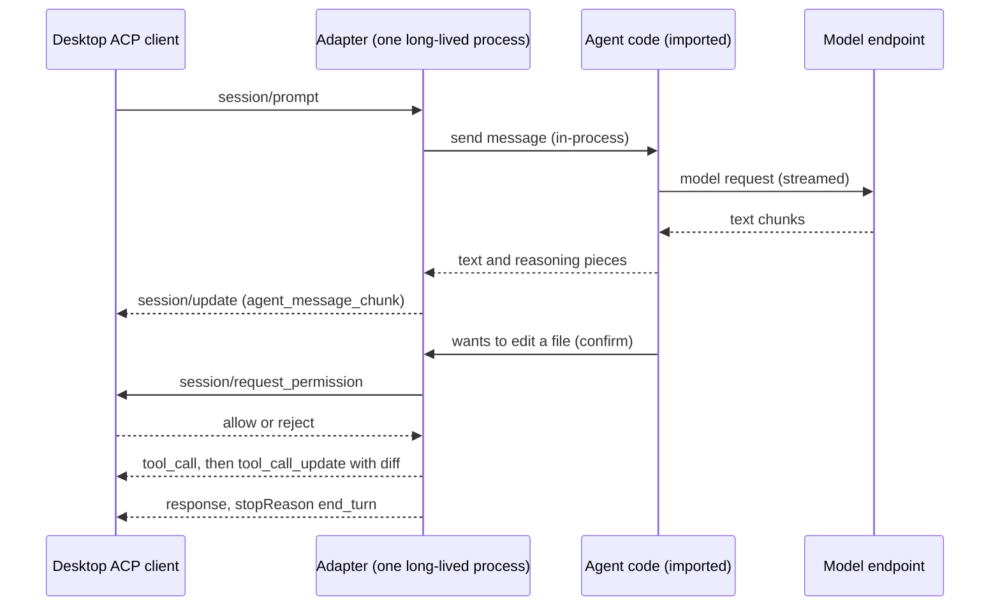

# acp-adapter-research

A small research project. It tests whether a coding agent that has no ACP support
can be wrapped by an adapter, and how to check that the adapter works.

Status: research code. It is not a product.

## What ACP is

ACP means Agent Client Protocol. It is a way for a desktop client (an editor or app)
to talk to a coding agent. The client sends messages such as "start a session" or
"run this prompt". The agent sends back streamed text, edit cards, and questions such as
"may I edit this file?". Both sides use JSON-RPC 2.0 over stdin and stdout, one message per line.

## Why agents without ACP are a gap

Many good coding agents have no ACP support. A user who wants to use them from a
desktop client has to use a terminal. The client cannot show streaming text,
permission cards, or Stop buttons for them.

An adapter fills that gap. It is a small program that speaks ACP on one side and
drives the agent on the other side.

## The levels of integration

There are several ways to connect an agent to a client. From best to least work:

1. **Native.** The agent speaks ACP itself.
2. **In-process adapter.** A long-lived program imports the agent's Python code and
   calls it directly. It can see each step and answer each question. This is the approach here.
3. **Hooks.** The agent offers hook points, and a wrapper reacts to them.
4. **JSON output.** The agent can print machine-readable events. The adapter parses them.
   It can see the events but cannot answer questions in the middle of a step.
5. **Plain text.** The adapter only reads the agent's text output. This is the weakest level.
   It cannot tell a real permission question from ordinary text.

The lower the level, the more guessing the adapter has to do.

## How Claude's adapter wraps an SDK

A Claude adapter wraps an SDK instead of a terminal program. The SDK runs the agent loop.
The adapter maps the SDK's events to ACP updates, and maps the SDK's permission
check to `session/request_permission`. The client answers, and the adapter acts on the answer.

## The idea

A long-lived process imports the agent's code. It keeps one session open, and it
turns the agent's confirm step into `session/request_permission`. When the client says
no, the change does not happen. When the client says yes, the change is made.



## How the Aider adapter maps things

The Aider adapter is `adapters/aider_adapter.py`. It runs Aider in the same process.

| Aider thing | ACP message |
| --- | --- |
| Streamed answer text | `session/update` with `agent_message_chunk` |
| Reasoning text and its tags | `agent_thought_chunk` (never shown as answer text) |
| SEARCH/REPLACE edit block | `tool_call` (kind `edit`), then `tool_call_update` with a `diff` |
| Aider asks to add or edit a file | `session/request_permission` |
| Shell command the model suggests | permission (kind `execute`), then `tool_call` with the output |
| Aider's second question, "add command output to the chat?" | not sent to the client; yes only if the command was allowed |
| Prompt token count and window size | `usage_update` with `used` and `size` |
| Model and effort choice | `session/set_config_option`, listed in `configOptions` |
| Cancel | `session/cancel`, the turn ends with `stopReason: cancelled` |
| Model error (for example HTTP 401) | JSON-RPC error response with a message |
| File paths | only files inside the session folder are offered or read |

## The generator idea: brief, checker, retry

1. Give a model the neutral brief (`ADAPTER-BRIEF.md`). The brief says what the adapter must do. It names no agent.
2. Run the checker (`checks/check_adapter.py`) on the adapter the model wrote.
3. If any probe fails, give the failing probe names and output back to the model, and retry.

The brief and the checker are the only spec. Nothing in them is tuned to one agent.

## Why fake models must depend on the input

A fake model that always returns the same reply lets an adapter pass by hard-coding
that reply. So the mock model in `checks/check_adapter_mock.py` picks its reply from a
marker in the prompt. For an edit probe, the mock only answers with the edit if the
request holds the marker that the test wrote into the file. The adapter must send the
real file content to pass. A hard-coded answer does not pass.

## Why protocol checks are not enough

Protocol checks show that the messages are right once. They do not show that the adapter
keeps working over many turns, cancels, errors and restarts. One adapter in this project
passed all 16 protocol checks, then failed the stability test badly. That is why there is a
separate stress test (`checks/stress_adapter.py`).

## Results

Facts only. The Aider adapter was written by a Haiku-class model from the brief,
with hand fixes afterwards.

| Check | Aider adapter (0.86.2) | Open Interpreter adapter |
| --- | --- | --- |
| Protocol checker, fake model | 20 pass, 1 skip | 16 of 16 pass |
| Real-test harness, mock model | 12 of 12 pass | not listed |
| Stability (stress), fake model | 16 of 17 pass | 17 of 17 pass |
| Real DeepSeek model | 12 of 12 pass | 12 of 12 pass |
| Existing-file edit, real DeepSeek | 5 of 5 pass | not listed |

Notes on the table:

- The Aider skip is the usage probe. The mock model has no known context window, so there is no usage update to check.
- The one Aider stability failure is a Python-block scenario. It does not apply to Aider, which uses its own edit format.
- The real DeepSeek and existing-file edit results are from an earlier version of the Aider adapter, before display polish.
- The Open Interpreter adapter is not included here. Its licence (AGPL-3.0) needs a check first.

Seen working in a real desktop ACP client: streaming, permission cards, edit and command cards, Stop, and context numbers.

## Limits

- Tested on Windows only.
- Model and effort choices are accepted by the adapter. They are not proven to reach the model.
- Stability is tested on the fake model only.
- Only agents whose code can be imported work with this approach.
- An agent update can break the adapter.
- The Aider adapter uses Aider internals, so it depends on the Aider version.
- This is not a sandbox. The checker tests behaviour. It cannot prove that code is safe.

## Requirements

Use a virtual environment with the Aider version that was tested:

```
python -m venv .venv
.venv\Scripts\activate
pip install aider-chat==0.86.2
```

Python 3 is needed for the checker scripts. They use only the standard library, plus the
Aider environment for the adapter.

## How to run

Use absolute paths for `--cmd`. Replace `<venv python>` with the Python in your venv, for example
`<repo>/.venv/Scripts/python.exe`.

Protocol checker, fake model (no network, no key):

```
python checks/check_adapter.py --cmd "\"<venv python>\" \"<repo>/adapters/aider_adapter.py\""
```

Real-test harness, fake model:

```
python checks/run_adapter_real.py --mock --python "<venv python>"
```

Real-test harness, real model. It asks for an OpenRouter key with getpass. The key is
never printed or saved, and it is not in any file:

```
python checks/run_adapter_real.py
```

Stability stress test, fake model. Use `--quick` for a short run:

```
python checks/stress_adapter.py --quick --python "<venv python>"
```

Results files are written into `checks/` and are ignored by git. The checks start and
stop their own processes by PID only. They never kill by image name.

## Files

- `ADAPTER-BRIEF.md`: the neutral brief and the rules for an adapter.
- `adapters/aider_adapter.py`: the Aider adapter.
- `checks/check_adapter.py`: the protocol checker. `check_adapter_client.py` is its stdio client.
- `checks/check_adapter_mock.py`: the scripted fake model.
- `checks/stub_adapter.py`: a fake adapter that must fail most probes. It proves the checker is not easy to fool.
- `checks/stress_adapter.py`: the stability test.
- `checks/run_adapter_real.py`: the real-test harness, with `--mock` for the fake model.

## Licence and notices

Code in this repository is MIT licensed. See `LICENSE`.
Aider is not included. See `NOTICE.md`.
